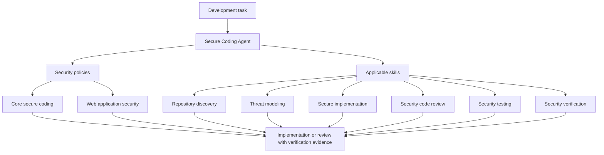

# Secure Web Application Developer Assistant

A modular GitHub Copilot custom agent for building, refactoring, testing, reviewing, and documenting web applications with secure coding practices by default.


## Overview

The Secure Web Application Developer Assistant integrates application security into everyday software development rather than treating it as a separate, post-development activity. It follows a shift-left security approach in which security, privacy, reliability, maintainability, and accessibility are acceptance criteria for every applicable change.

Version 2.0 modernizes the original standalone agent into a modular configuration consisting of **one custom agent, two security policy files, and six specialized skills**. The agent remains framework-independent and applies security controls proportionally to the task, application architecture, and actual risk. 

**Keep in mind that I never actually released version 1 because it's not good.**

## Features

- **Secure by design and by default:** Identify applicable security risks before implementation and preserve existing security controls.
- **OWASP-aligned development:** Use OWASP Top 10:2025 for risk identification, ASVS 5.0.0 for verifiable requirements, and OWASP Cheat Sheets for implementation guidance.
- **Repository-aware implementation:** Inspect existing architecture, dependencies, framework versions, conventions, tests, and security mechanisms before making changes.
- **Full-stack security:** Address authentication, authorization, input validation, injection, browser security, APIs, databases, caching, cryptography, file handling, and software supply chain risks.
- **Change-level threat modeling:** Identify assets, trust boundaries, abuse cases, and appropriate security controls for sensitive changes.
- **Actionable code reviews:** Report evidence-based findings with severity, confidence, affected locations, remediation, and suggested regression tests.
- **Meaningful security testing:** Cover permitted and prohibited behavior, access boundaries, exceptional conditions, and security regressions.
- **Evidence-based verification:** Report actual validation results, unavailable checks, unresolved assumptions, and residual risks.
- **Agent operational security:** Treat potentially adversarial content as untrusted, protect secrets, preserve user changes, and respect tool permissions and approval boundaries.

## Architecture

The project separates agent behavior, security policy, and procedural workflows while retaining one central development agent.



| Layer | Responsibility |
| --- | --- |
| Agent | Identity, scope, mandatory safeguards, security decisions, skill selection, and completion criteria. |
| Instructions | Detailed security requirements and technical constraints. |
| Skills | Reusable procedures for specific development, review, testing, and verification tasks. |

Mandatory safeguards remain in the agent itself. Supporting policies must be read before substantive implementation or review, and relevant skills are selected based on the task. If native skill activation is unavailable, the agent is instructed to read the corresponding skill file directly.

## Repository structure

```text
.
├── .github/
│   ├── agents/
│   │   └── secure-coding.agent.md
│   ├── instructions/
│   │   ├── secure-coding.instructions.md
│   │   └── web-application-security.instructions.md
│   └── skills/
│       ├── repository-discovery/
│       │   └── SKILL.md
│       ├── threat-modeling/
│       │   └── SKILL.md
│       ├── secure-implementation/
│       │   └── SKILL.md
│       ├── security-code-review/
│       │   └── SKILL.md
│       ├── security-testing/
│       │   └── SKILL.md
│       └── security-verification/
│           └── SKILL.md
├── INSTALL.md
└── README.md
```

### Agent and instructions

| File | Description |
| --- | --- |
| [secure-coding.agent.md](http://github.com/PoseidonLEL/Secure-Coding-Agent/blob/main/agents/secure-coding.agent.md) | Central agent definition, operational safeguards, workflow selection, and verification requirements. |
| [secure-coding.instructions.md](https://github.com/PoseidonLEL/Secure-Coding-Agent/blob/main/instructions/secure-coding.instructions.md) | Core security policy covering OWASP risks, injection prevention, cryptography, configuration, dependencies, logging, error handling, and engineering quality. |
| [web-application-security.instructions.md](https://github.com/PoseidonLEL/Secure-Coding-Agent/blob/main/instructions/web-application-security.instructions.md) | Full-stack security policy covering identity, access control, frontend, backend, APIs, persistence, caching, and file handling. |

The policy files intentionally omit `applyTo` patterns. The custom agent explicitly reads both policies rather than deliberately applying the entire security policy to every Copilot agent in a repository. Actual discovery and activation behavior depends on the host environment.

### Skills

| Skill | When to use |
| --- | --- |
| [repository-discovery](https://github.com/PoseidonLEL/Secure-Coding-Agent/blob/main/skills/repository-discovery/SKILL.md) | Working with an unfamiliar repository or application component. |
| [threat-modeling](https://github.com/PoseidonLEL/Secure-Coding-Agent/blob/main/skills/threat-modeling/SKILL.md) | Changing trust boundaries, identity, sensitive data, integrations, or security-sensitive workflows. |
| [secure-implementation](https://github.com/PoseidonLEL/Secure-Coding-Agent/blob/main/skills/secure-implementation/SKILL.md) | Creating, modifying, or refactoring application code. |
| [security-code-review](https://github.com/PoseidonLEL/Secure-Coding-Agent/blob/main/skills/security-code-review/SKILL.md) | Reviewing code, assessing suspected vulnerabilities, or reviewing security-sensitive changes. |
| [security-testing](https://github.com/PoseidonLEL/Secure-Coding-Agent/blob/main/skills/security-testing/SKILL.md) | Designing and updating tests for security-sensitive behavior. |
| [security-verification](https://github.com/PoseidonLEL/Secure-Coding-Agent/blob/main/skills/security-verification/SKILL.md) | Verifying substantive development changes and reporting validation evidence. |

## Getting started

### Prerequisites

- Visual Studio Code with GitHub Copilot available and enabled, or a compatible Copilot environment that supports custom agents, instructions, and skills.
- Access to the web application repository you intend to work on.
- The application's existing runtime, package manager, and development tools as needed for implementation and validation.

The configuration itself consists of Markdown files. It requires no separate package installation, custom scripts, MCP servers, or external security scanners.

### Option 1: Repository installation (recommended)

1. Download or clone this repository.
2. Copy its `.github` directory into the root of your web application repository.
3. Merge with an existing `.github` directory instead of replacing it. Preserve existing workflows, instructions, and other customizations; review matching filenames before overwriting.
4. Open the application repository in VS Code and start a new Copilot chat.
5. Select **Secure Web Application Developer Assistant** from the agent picker.

For example, on Windows:

```text
C:\Projects\MyWebApp\.github\agents\secure-coding.agent.md
C:\Projects\MyWebApp\.github\instructions\secure-coding.instructions.md
C:\Projects\MyWebApp\.github\skills\repository-discovery\SKILL.md
```

Copy all nine configuration files, retaining their original directory structure and filenames.

### Option 2: Personal installation (Windows)

For compatible Copilot harnesses supporting personal configuration under `.copilot`, copy the contents of this project's `.github` directory into:

```text
%USERPROFILE%\.copilot\
```

The resulting directory should contain `agents`, `instructions`, and `skills` directly. Do not copy the `.github` wrapper into `.copilot`.

Personal configuration locations and tool availability may differ by IDE, harness, and remote development environment. Use one installation method initially to avoid duplicate names.

See [INSTALL.md](INSTALL.md) for the complete installation tree, configuration notes, troubleshooting, and a read-only smoke test.

## Usage

Select the custom agent in GitHub Copilot Chat and describe the development task normally. The agent is instructed to choose relevant skills automatically and keep the workflow proportional to the change. In compatible environments, skills may also be selected through the `/` menu.

### Example prompts

**Feature implementation**

> Implement an authenticated invoice download endpoint. Enforce object ownership and tenant isolation on the server, reuse existing security controls, and add tests for permitted and denied requests.

**Security-focused code review**

> Review the current changes for security vulnerabilities and regressions. Report prioritized findings with file locations, evidence, impact, remediation, and suggested tests. Do not modify files.

**Secure refactoring**

> Refactor the account recovery workflow using existing project conventions. Preserve token expiration, single-use semantics, rate limiting, and account enumeration protections.

**Threat modeling**

> Assess the security implications of adding a file upload feature. Identify trust boundaries, abuse cases, required controls, and a verification plan before implementation.

**Security verification**

> Review the final diff and run applicable project validation checks. Report actual results, unverified controls, and residual security risks.

## Security coverage

The agent uses the [OWASP Top 10:2025](https://top10.owasp.org/2025/) as a baseline for identifying web application risks:

| Category | Risk |
| --- | --- |
| A01 | Broken Access Control |
| A02 | Security Misconfiguration |
| A03 | Software Supply Chain Failures |
| A04 | Cryptographic Failures |
| A05 | Injection |
| A06 | Insecure Design |
| A07 | Authentication Failures |
| A08 | Software or Data Integrity Failures |
| A09 | Security Logging and Alerting Failures |
| A10 | Mishandling of Exceptional Conditions |

[OWASP ASVS 5.0.0](https://asvs.owasp.org/) supplements the Top 10 with applicable, verifiable application security requirements. The agent uses these standards proportionally; their inclusion does not establish ASVS compliance or security certification.

## Verification and definition of done

The agent is instructed to review its final changes, add or update relevant tests, run applicable project checks where available and appropriate, and document unresolved risks. It must not weaken security controls or fabricate verification results.

Material security controls are classified as:

| Status | Meaning |
| --- | --- |
| `VERIFIED` | Available evidence supports the applicable control. |
| `FAILED` | Evidence indicates that the control does not meet its requirements. |
| `NOT VERIFIED` | The control could not be adequately verified. |
| `NOT APPLICABLE` | The control is not relevant to the assessed change. |

Validation commands and actual results should be reported separately, including failed, skipped, or unavailable checks.

## Tool access and limitations

The agent requests the following Copilot tool aliases:

```yaml
tools: [read, search, edit, execute]
```

Actual permissions, sandboxing, and approval policies are controlled by the host. The agent does not request subagent delegation, web browsing, or MCP tools. It is instructed not to circumvent tool restrictions or perform unauthorized destructive, privileged, or production operations.

This project is designed for secure web application development, not penetration testing, external vulnerability scanning, incident response, production administration, or compliance certification.

> [!IMPORTANT]
> Agent instructions and skills are behavioral guidance, not deterministic security enforcement. AI-generated code must still be reviewed and verified. Keep existing CI gates, security scanners, secret scanning, dependency audits, tests, and permission controls enabled.

The v2.0 package was statically validated for file structure, YAML parsing, and internal links. Live Copilot discovery, skill activation, and effectiveness against a real application repository have not yet been established. Use the smoke test in [INSTALL.md](INSTALL.md) to verify your installation.

## Contributing

Proposed improvements should preserve the original scope and framework independence of the agent. Keep mandatory safeguards in the central definition, detailed technical requirements in the policies, and repeatable procedures in skills.

When proposing changes, explain the security or engineering rationale, avoid unnecessary duplication, verify referenced standards and configuration syntax, and test agent behavior where possible. Use synthetic examples and do not include real secrets or confidential application data.

## References

- [OWASP Top 10:2025](https://top10.owasp.org/2025/)
- [OWASP Application Security Verification Standard](https://asvs.owasp.org/)
- [OWASP Cheat Sheet Series](https://cheatsheetseries.owasp.org/)
- [OWASP Web Security Testing Guide](https://owasp.org/www-project-web-security-testing-guide/)
- [Common Weakness Enumeration (CWE)](https://cwe.mitre.org/)
- [GitHub Copilot custom agent configuration](https://docs.github.com/en/copilot/reference/custom-agents-configuration)
- [VS Code agent skills](https://code.visualstudio.com/docs/agent-customization/agent-skills)
- [VS Code custom agent file reference](https://code.visualstudio.com/docs/agents/reference/custom-agent-file-reference)
- [VS Code custom instructions reference](https://code.visualstudio.com/docs/agents/reference/custom-instructions-reference)

## License

No license has been specified for this project. A license should be selected by the repository owner before granting others permission to reuse, modify, or redistribute the configuration.
